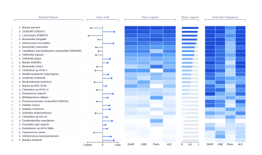
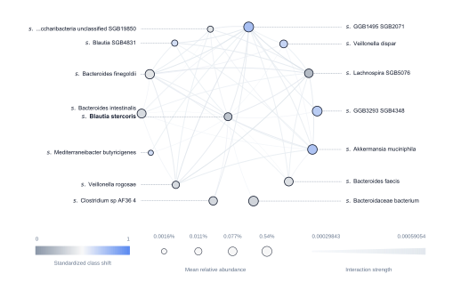
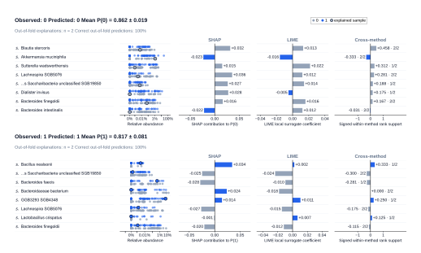
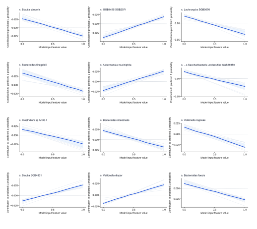

<i>Research use only. Not a medical device.
This software was developed in the HEREDITARY project as a research prototype. It has not been assessed or certified under the EU Medical Device Regulation (EU) 2017/745. It must not be used to diagnose, treat, monitor or make any other decision about individual patients.</i>
***

<p>
  
</p>

<b>E</b>valuate, <b>e</b>nsemble, <b>e</b>xplain machine learning for microbiota data analysis in single-modality and multimodality scenarios.

<table>
  <tr>
    <td width="50%" valign="top" align="center">
      <a href="assets/example-outputs/feature_support__1.svg">
        
      </a>
      <br>
      <strong>Feature importance and stability</strong>
    </td>
    <td width="50%" valign="top" align="center">
      <a href="assets/example-outputs/interaction_network_current__1.svg">
        
      </a>
      <br>
      <strong>Feature interaction networks</strong>
    </td>
  </tr>
  <tr>
    <td width="50%" valign="top" align="center">
      <a href="assets/example-outputs/local_explanations.svg">
        
      </a>
      <br>
      <strong>Sample-level feature contributions</strong>
    </td>
    <td width="50%" valign="top" align="center">
      <a href="assets/example-outputs/ale_curves__1.svg">
        
      </a>
      <br>
      <strong>Feature-specific effects on predicted class probability</strong>
    </td>
  </tr>
</table>


### Definitions

> An integrated leakage-controlled framework for microbiome machine learning that jointly handles compositional preprocessing and taxonomic representation selection, subject/cohort-aware nested evaluation, inner-OOF ensemble and multimodal model construction, cross-fitted explanation, and uncertainty/robustness analysis.

> mllabiome addresses a methodological gap between general-purpose machine-learning libraries and microbiome-specific analytical workflows. Its distinguishing feature is an evaluation architecture in which microbiome representation, preprocessing, model optimization, ensemble construction, and multimodal integration can be evaluated within the same nested, group-aware resampling hierarchy. This design allows analytical choices that are commonly fixed before cross-validation to be treated as model-selection decisions. The framework additionally propagates this separation to model interpretation and robustness analyses, providing a common provenance structure from preprocessing through prediction and explanation.

`mllabiome` is a Python library for **microbiome machine learning**, designed for rigorous phenotype prediction, model benchmarking, ensemble learning, multimodal integration, explainable AI, and cross-cohort validation.

It provides an end-to-end workflow for evaluating combinations of **microbiome representations, abundance transformations, taxonomic resolutions, machine-learning models, and ensembles** using nested validation procedures that keep preprocessing and model selection inside the training data.

Use `mllabiome` when you need to build or benchmark predictive models from microbiome abundance data without leaking information from held-out samples.

### What it does

- **Nested cross-validation** and repeated nested cross-validation
- **Subject-aware grouped splitting** for repeated or longitudinal samples
- **Leave-one-dataset-out (LODO)** and cross-cohort evaluation
- **Leakage-controlled preprocessing** fitted within training partitions
- Microbiome transformations including relative abundance, presence/absence, Hellinger, arcsine-square-root, CLR, ALR, ILR, and prevalence filtering
- Evaluation across **taxonomic resolutions**
- Classification and regression
- scikit-learn-compatible models plus XGBoost, LightGBM, CatBoost, AutoML, and SIAMCAT integration
- **Ensemble learning** using inner out-of-fold predictions
- **Multimodal learning** with early, intermediate, and late integration
- **Explainable AI** using permutation importance, SHAP, ALE, LIME, and ALE interactions
- Cross-fitted explanations based on held-out predictions
- Robustness and feature-stability analyses
- Exploratory microbiome analysis, including community-level statistics and differential abundance
- Publication-oriented tables, figures, prediction files, and HTML reports

### Why mllabiome?

Microbiome machine-learning workflows are unusually vulnerable to optimistic performance estimates when feature filtering, transformations, model selection, repeated samples, or dataset structure are handled outside the validation procedure.

`mllabiome` is designed around a simple rule:

> **Information from a held-out sample must not influence the pipeline used to predict that sample.**

Accordingly, preprocessing and candidate selection are performed within the appropriate training partitions, repeated samples can be kept at the subject level, and ensemble members are selected from inner out-of-fold predictions before evaluation on the outer test data.

This makes `mllabiome` particularly suited to **microbiome phenotype prediction, microbiome ML benchmarking, cross-study validation, and reproducible evaluation of predictive microbiome signatures**.

### Install

Python 3.10 or newer is required.

```bash
uv pip install mllabiome
```

or:

```bash
pip install mllabiome
```

To install every dependency:
```bash
uv sync --all-groups
uv sync --all-extras --all-groups
```

To use benchmark datasets:
```bash
uv pip install --group benchmark
```

To use FMs and benchmark datasets:
```bash
uv sync --extra foundation --group benchmark
uv sync --extra foundation --extra tabpfn --group benchmark
```
For development from a checked-out repository:

```bash
uv venv
source .venv/bin/activate
uv pip install -e ".[dev]"
uv run pytest -q
```

### Quick start

Analyses are defined in Python configuration files and can be run end-to-end:

```bash
mllabiome examples/base/ncv__lampp_scz_cm_configs_sweep.py
```

or stage by stage:

```bash
mllabiome examples/base/ncv__lampp_scz_cm_configs_sweep.py --stage explore
mllabiome examples/base/ncv__lampp_scz_cm_configs_sweep.py --stage evaluate
mllabiome examples/base/ncv__lampp_scz_cm_configs_sweep.py --stage ensemble
mllabiome examples/base/ncv__lampp_scz_cm_configs_sweep.py --stage explain
mllabiome examples/base/ncv__lampp_scz_cm_configs_sweep.py --stage robustness
mllabiome examples/base/ncv__lampp_scz_cm_configs_sweep.py --stage report
```

Or check further examples in examples folder, such as examples/multimodal_regression__gutbrain_sweep.py for mulitmodal microbiota-gut-brain axis example.

For cross-study validation:

```bash
mllabiome examples/base/lodo__lampp_crc_cm_configs_sweep.py --stage evaluate
```

The main workflow is:

```text
explore → evaluate → ensemble → inference → explain → robustness → report
```

### Typical use cases

`mllabiome` is intended for questions such as:

- Which preprocessing and machine-learning pipeline generalizes best for a microbiome phenotype?
- How should microbiome models be compared using nested cross-validation?
- How well does a microbiome classifier generalize to unseen cohorts?
- Which taxonomic resolution or abundance transformation is most useful for prediction?
- Can multiple omics or clinical modalities improve prediction?
- Does an ensemble improve over individual microbiome models?
- Which microbial features consistently influence held-out predictions?
- How stable are model explanations across folds, cohorts, and analysis choices?

### Data

`mllabiome` operates on already quantified feature or abundance tables together with sample metadata.

Supported workflows include wide tabular data and feature-by-sample microbiome profiles such as MetaPhlAn-style taxonomic abundance tables.

`mllabiome` is **not** a raw sequencing pipeline: read QC, assembly, taxonomic profiling, and generation of abundance tables should be performed upstream.

### Models and representations

Any compatible scikit-learn estimator can be included in a model sweep. Common workflows can combine models such as logistic regression, random forests, ExtraTrees, XGBoost, LightGBM, CatBoost, neural networks, SIAMCAT, and AutoML methods.

Microbiome representations can be evaluated across taxonomic levels and abundance transformations within the same validation framework.

### Multimodal analysis

`mllabiome` supports unimodal and multimodal prediction, including:

- early feature concatenation
- modality-specific intermediate representations
- joint intermediate representations
- late prediction integration
- weighted prediction integration
- stacked / Super Learner-style integration

Integration choices are evaluated within the same held-out evaluation framework.

### Explainability

Model interpretation is available for selected individual models and ensembles using:

- permutation importance
- SHAP
- accumulated local effects (ALE)
- ALE interactions
- LIME

Where applicable, explanations are generated from models for which the explained observations were held out during model fitting.

Feature attribution should be interpreted as **model-based evidence and hypothesis generation**, not as proof of causal biological effects.

### Outputs

A run can produce:

- out-of-fold predictions
- classification or regression metrics
- candidate rankings
- selected model and ensemble specifications
- statistical comparisons
- explainability results
- robustness analyses
- publication-ready figures
- machine-readable result tables
- an integrated HTML report

Tabular results can also be exported as TSV and figures as i.e. PNG, SVG.

### Reproducibility

`mllabiome` records analysis configurations and separates model selection from held-out performance estimation.

For reproducible research, analyses should be run from a fixed `mllabiome` release together with the exact configuration, dataset version, software environment, and random seed used for the study.

Optional R-backed functionality uses version-controlled integrations for SIAMCAT and ANCOM-BC2.

### Examples

Runnable configurations are available in [`examples/`](examples/), including:

- grouped repeated nested cross-validation
- leave-one-dataset-out evaluation
- microbiome transformation and taxonomic-resolution sweeps
- ensemble selection
- explainability and robustness analysis

- **Federated learning (experimental):** Privacy-aware, cross-study microbiome classification using Flower SecAgg+ and the LAMPP colorectal cancer benchmark. See the [federated learning example](examples/federated/README.md) for installation, configuration, and usage.

### Scope

`mllabiome` focuses on **rigorous evaluation of predictive microbiome models**.

It complements upstream microbiome-processing tools and general-purpose machine-learning frameworks by providing microbiome-aware evaluation, representation search, cohort-aware validation, ensemble construction, explainability, and reporting in one workflow.

### Citation

If you use `mllabiome` in published research, please cite the software release and the accompanying methods paper.

Citation information will be provided in `CITATION.cff`.

### License

`mllabiome` is released under the Apache License 2.0.

### Keywords

Microbiome machine learning · microbiota machine learning · metagenomics · phenotype prediction · nested cross-validation · grouped cross-validation · leave-one-dataset-out · cross-cohort validation · compositional data · ensemble learning · multimodal learning · explainable AI · SHAP · ALE · LIME · microbiome biomarker discovery · bioinformatics · classifying gut microbiome profiles to predict a health condition · taxonomic profiling data · comparing model performance across validation approaches


### Acknowledgement

> Funded by the European Union under grant agreement No 101137074 (HEREDITARY). Views and opinions expressed are however those of the author(s) only and do not necessarily reflect those of the European Union or the European Health and Digital Executive Agency (HaDEA). Neither the European Union nor the granting authority can be held responsible for them.


#### Contact point: [Agata Polejowska](https://github.com/polejowska)